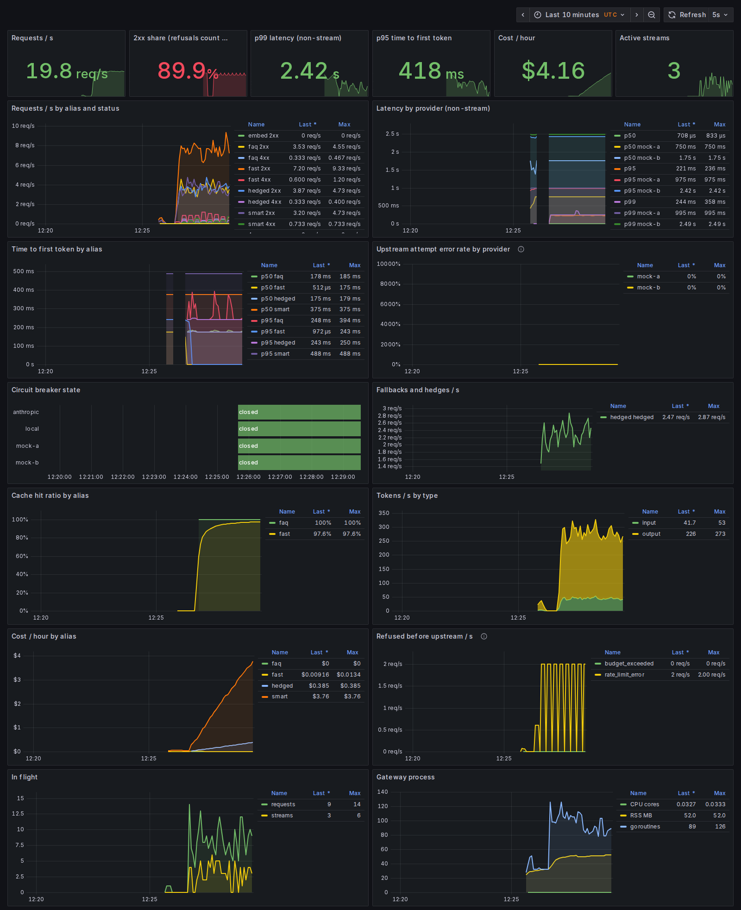
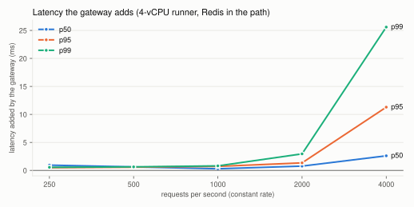
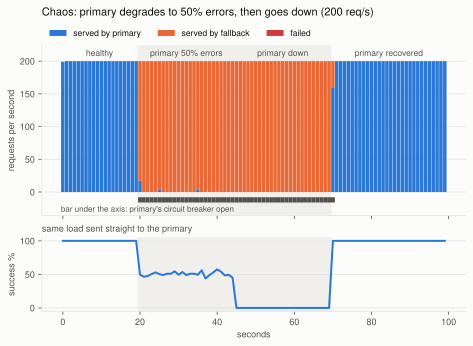
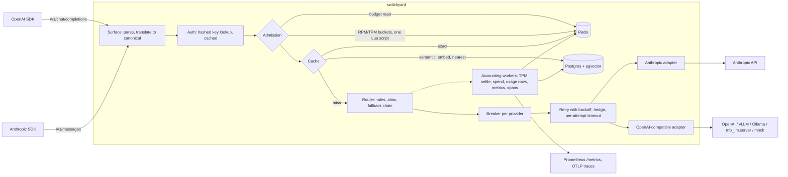

# switchyard

**Every LLM call your product makes goes through code you don't control.** Providers return 429s and 529s, go down for minutes, stream half an answer and stop, and bill per token with no per-customer ceiling. switchyard is a gateway you put in front of them: it speaks the OpenAI and Anthropic APIs, routes each request to a chain of providers, fails over before the first token, caches, enforces per-key rate limits and USD budgets across replicas, and shows all of it in Prometheus, OpenTelemetry and Grafana. It is written in Go and adds under a millisecond at moderate load.



<sub>The dashboard from the `docker compose --profile traffic` demo, screenshotted by CI. The demo traffic deliberately includes a key that runs into its rate limit, which is why the 2xx share is about 90%. Prices for the mock models are made up.</sub>

## What it does

- **Two API surfaces, one gateway.** OpenAI-compatible `/v1/chat/completions` and `/v1/embeddings`, and Anthropic-native `/v1/messages`, with streaming. Either surface can be served by an Anthropic or an OpenAI-compatible upstream (OpenAI, vLLM, Ollama, `mlx_lm.server`). Tool calls, system prompts, stop reasons and usage are translated, including mid-stream. The official OpenAI and Anthropic Python SDKs run against it in CI.
- **Routing and reliability.** Model aliases (`fast`, `smart`, `local`), rules by tenant, model and header, fallback chains, retries with full-jitter backoff that honour `Retry-After`, a circuit breaker per provider, optional hedged requests, per-attempt timeouts, and client disconnects that cancel the upstream call. Streams are retried or failed over only before the first token.
- **Multi-tenancy with limits and budgets.** API keys are stored as SHA-256 hashes. Per-key requests per minute and tokens per minute are token buckets in Redis, shared by every replica. Monthly USD budgets have a soft limit (a warning header) and a hard limit (402). Cost comes from a versioned price table and the usage each provider reports.
- **Caching.** An exact-match cache in Redis, scoped per tenant. A streamed request can be served from a non-streamed entry and the other way round. There is also an opt-in semantic cache on pgvector, with its trade-off measured below.
- **Observability.** OpenTelemetry traces with GenAI semantic-convention attributes and Prometheus metrics: latency, time to first token, tokens, cost, cache results, fallbacks, breaker state. There is a provisioned Grafana dashboard and structured JSON logs that never contain prompts unless a tenant opts in (redacted).
- **Operations.** An admin API, a `switchyardctl` CLI, a minimal admin page, `docker compose up` with a seeded demo key, and a Helm chart.

## Results

All benchmarks call the [mock provider](internal/mock), so they measure the gateway, not a model. The headline numbers come from a GitHub Actions `ubuntu-latest` runner (4 vCPU AMD EPYC 7763, 16 GB) at commit `59162a3`. Redis and Postgres are in the request path, and the load generator, mocks and databases share the same 4 vCPUs. A second run on an Apple M6 (12 cores, in-process limiter, no Redis) is in [`bench/results/m6-local`](bench/results/m6-local). Method and caveats: [`bench/README.md`](bench/README.md).

### Overhead: latency added over calling the mock directly

<picture>
  <source media="(prefers-color-scheme: dark)" srcset="docs/img/overhead-dark.svg">
  
</picture>

OpenAI surface to an OpenAI-compatible upstream, constant rate, 20 s per level, the mock answering in 20 ms:

| req/s | direct p50 / p99 (ms) | via gateway p50 / p99 (ms) | added p50 | added p95 | added p99 | gateway CPU (cores) | success |
|---:|---:|---:|---:|---:|---:|---:|---:|
| 250 | 20.48 / 21.32 | 21.42 / 21.88 | +0.94 | +0.48 | +0.55 | 0.22 | 100% |
| 500 | 20.47 / 21.30 | 21.10 / 21.93 | +0.63 | +0.57 | +0.63 | 0.44 | 100% |
| 1000 | 20.75 / 21.30 | 21.04 / 22.11 | +0.29 | +0.72 | +0.81 | 0.78 | 100% |
| 2000 | 20.45 / 21.40 | 21.21 / 24.36 | +0.77 | +1.34 | +2.96 | 1.27 | 100% |
| 4000 | 20.55 / 21.57 | 23.16 / 47.16 | +2.61 | +11.30 | +25.60 | 1.88 | 100% |

The Anthropic surface to an Anthropic upstream, where the body is forwarded as sent, tracks it closely: +0.64 / +0.83 ms (p50 / p99) at 250 req/s, and +3.8 / +40 ms at 4000 req/s, when the runner's 4 vCPUs are saturated. On the M6 the added p99 stays under 0.7 ms up to 4000 req/s.

### Throughput, streaming and memory

| | 4-vCPU runner (Redis) | M6 (no Redis) |
|---|---:|---:|
| Max sustained throughput, closed loop, 0 errors | **5,180 req/s** (256 workers, 2.1 cores, p99 100 ms) | **55,188 req/s** (64 workers, 4.5 cores, p99 5.5 ms) |
| The mock alone at the same concurrency | 27,614 req/s | 153,669 req/s |
| Added time to first token, p50 / p99 | +2.0 / +4.8 ms (OpenAI), +2.0 / +6.3 ms (Anthropic) | +1.2 / +2.9 ms, +1.0 / +1.5 ms |
| 1,000 concurrent streams | all completed, TTFT p99 3.1 ms, 317 MB RSS | all completed, TTFT p99 1.5 ms, 228 MB |
| 5,000 concurrent streams | all completed, TTFT p99 1.5 s, 780 MB | all completed, TTFT p99 2.9 ms, 658 MB |
| 10,000 concurrent streams | all completed, TTFT p99 11.8 s, 1.57 GB | 4,667 completed: macOS ran out of ephemeral ports |

What these say, plainly:
- **The gateway is cheap per request, and Redis is what costs on a small machine.** Every request makes about five Redis operations: a budget read and a bucket take before it, then TPM settlement and spend off the response path. On the runner, that plus sharing 4 vCPUs with everything else caps throughput near 5k req/s. A second runner sample peaked at 7.6k, so runner-to-runner variance is large. With the in-process limiter on the M6 it is 55k req/s.
- **Holding streams is cheap; opening thousands at once is not, on 4 vCPUs.** An open stream costs about 80 to 90 KB. Opening 10,000 within 2 seconds queues their admission, which is where the 11.8 s p99 comes from.
- **The first benchmark run caught two real problems.** Accounting ran before the response finished, adding five sequential Redis round trips to every request (a 3.3k req/s ceiling and +1.3 ms at low load). And each stream held a 64 KB read buffer. Both fixes are in the history (the `perf:` commits), and the numbers above are after them.

### Chaos: the primary provider degrades, then dies

<picture>
  <source media="(prefers-color-scheme: dark)" srcset="docs/img/chaos-dark.svg">
  
</picture>

200 req/s at an alias with a primary and a fallback provider. The primary gets 50% 503s at t=20 s, refuses all connections at t=45 s, and recovers at t=70 s. The same load is sent straight to the primary as a baseline.

| Phase | Through the gateway | Straight to the primary | Served by the fallback | Gateway p99 |
|---|---:|---:|---:|---:|
| healthy | 3,999 / 3,999 (100%) | 100% | 0% | 22.0 ms |
| primary 50% errors | 5,000 / 5,000 (100%) | 50.5% | 99.5% | 22.1 ms |
| primary down | 5,000 / 5,000 (100%) | 0% | 100% | 22.0 ms |
| primary recovered | 6,000 / 6,000 (100%) | 100% | 0.7% | 22.0 ms |

**0 of 19,999 requests failed.** The primary's breaker opened within the first second of the degradation (at 200 req/s it collects its 10 calls in about 50 ms). It stayed open through both failure phases, because each half-open probe failed. In this run traffic moved back to the primary within a second of recovery; the worst case is the 5 s `open_for`. The M6 run gives the same result: 19,982 of 19,982.

### Semantic cache: hit rate vs wrong hits

The semantic cache returns an earlier answer when a new prompt embeds close enough to an old one. Its risk is answering a *different* question. The test set is 80 hand-labeled pairs in [`bench/semantic`](bench/semantic): 40 paraphrases, and 40 near-duplicates that need a different answer (swapped direction, entity, number, polarity).

| Threshold | all-MiniLM-L6-v2: paraphrases hit | wrong hits | bge-base-en-v1.5: paraphrases hit | wrong hits |
|---:|---:|---:|---:|---:|
| 0.85 | 92% | 48% | 95% | 62% |
| 0.90 | 72% | 25% | 80% | 32% |
| 0.95 | 40% | 12% | 45% | 10% |
| 0.97 | 22% | 5% | 20% | 5% |
| 0.99 | 8% | 2% | 8% | 2% |

No threshold is safe for general traffic. "Exchange rate from USD to EUR" vs "from EUR to USD" scores 0.995 on both models, and "convert 5 km to miles" vs "5 miles to km" scores 0.985. That is why the semantic cache is opt-in per alias, scoped to an identical system prompt, history and `max_tokens`, and skipped for requests with tools or images. It fits FAQ-style aliases where a near-miss answer is acceptable. With 40 pairs per class, each pair moves a rate by 2.5 points. As a baseline, the mock's bag-of-words embedding catches 8% of paraphrases at 0.95.

## Architecture



Inside, every request is the Anthropic Messages shape (`internal/llm`): content blocks, `tool_use`/`tool_result` pairs and typed stream events. The OpenAI surface and OpenAI-compatible upstreams are translated to and from it (`internal/translate`). A request that arrives on `/v1/messages` and goes to Anthropic is forwarded byte for byte, with only the model rewritten. Fields the gateway doesn't model, such as `thinking`, `output_config` and `cache_control`, survive, and so do the upstream's stream events.

| Package | Role |
|---|---|
| `internal/server` | HTTP surfaces, auth, error envelopes, SSE relays |
| `internal/gateway` | Admission (model allowlist, budget, limits), cache lookup, accounting |
| `internal/router` | Rules, aliases, fallback chains, retries, breakers, hedging, stream peeking |
| `internal/provider` | Anthropic and OpenAI-compatible adapters |
| `internal/translate` | OpenAI to Messages and back, whole and streamed |
| `internal/limiter`, `internal/budget`, `internal/pricing` | Token buckets, monthly spend, versioned prices |
| `internal/cache` | Exact (Redis) and semantic (pgvector) caches, stream replay |
| `internal/telemetry` | Metrics, GenAI spans, redacted capture |
| `internal/admin`, `cmd/switchyardctl` | Admin API, page and CLI |
| `internal/mock`, `cmd/mockllm` | The mock provider |

## Quickstart

You need Docker. From a clean clone:

```bash
git clone https://github.com/nikolasss4/switchyard && cd switchyard
docker compose up --build -d --wait
```

That starts the gateway on `:8080` (admin and metrics on `127.0.0.1:9091`), Postgres with pgvector, Redis, two mock providers, Prometheus and Grafana on `127.0.0.1:3000`. A demo key, `sy_demo0000_demodemodemodemodemodemodemodemo`, is seeded. The demo aliases are `fast`, `smart`, `hedged`, `faq` (semantic cache) and `embed`, all served by the mocks. `haiku`, `sonnet` and `opus` go to Anthropic if you start compose with `ANTHROPIC_API_KEY` set.

Point either official SDK at it by changing only the base URL:

```python
from openai import OpenAI

client = OpenAI(base_url="http://localhost:8080/v1", api_key="sy_demo0000_demodemodemodemodemodemodemodemo")
stream = client.chat.completions.create(model="fast", messages=[{"role": "user", "content": "hello"}], stream=True)
for chunk in stream:
    if chunk.choices:
        print(chunk.choices[0].delta.content or "", end="")
```

```python
import anthropic

client = anthropic.Anthropic(base_url="http://localhost:8080", api_key="sy_demo0000_demodemodemodemodemodemodemodemo")
msg = client.messages.create(model="smart", max_tokens=200, messages=[{"role": "user", "content": "hello"}])
print(msg.content[0].text)
```

Every response says how it was served: `X-Switchyard-Provider`, `X-Switchyard-Model`, `X-Switchyard-Attempts`, `X-Switchyard-Fallback-Depth`, `X-Switchyard-Cache`, `X-Request-Id`.

Then watch it:

```bash
docker compose --profile traffic up -d traffic   # a steady mix of demo requests
open http://localhost:3000                       # the Switchyard dashboard
docker compose stop mock-a                       # `fast` fails over to mock-b; the breaker panel turns red
docker compose start mock-a
```

Manage keys with the CLI inside the gateway container, or with the page at `http://localhost:9091/admin` (token `demo-admin-token`):

```bash
docker compose exec gateway switchyardctl tenants put acme --name "Acme"
docker compose exec gateway switchyardctl keys create --tenant acme --name ci --rpm 600 --tpm 200000 --budget 25
docker compose exec gateway switchyardctl usage --since 1h
```

### Without Docker

```bash
go build -o bin/ ./cmd/...
./bin/mockllm -addr 127.0.0.1:9101 -name mock-a &
./bin/mockllm -addr 127.0.0.1:9102 -name mock-b &
DATABASE_URL=postgres://... REDIS_URL=redis://localhost:6379/0 SWITCHYARD_ADMIN_TOKEN=... \
  SWITCHYARD_DEMO_KEY=sy_demo0000_demodemodemodemodemodemodemodemo ./bin/switchyard -config configs/local.yaml
```

`REDIS_URL` is optional: without it, limits, budgets and the exact cache are per instance. The semantic cache needs Postgres with pgvector; remove the `faq` alias's `semantic` setting if yours doesn't have it.

### Kubernetes

```bash
kubectl create secret generic switchyard --from-literal=DATABASE_URL=... --from-literal=REDIS_URL=... \
  --from-literal=SWITCHYARD_ADMIN_TOKEN=... --from-literal=ANTHROPIC_API_KEY=...
helm install sy deploy/helm/switchyard
```

The chart runs as non-root on a read-only filesystem. It keeps the admin/metrics port on a separate ClusterIP service and adds Prometheus scrape annotations.

## Configuration

A full example is [`configs/demo.yaml`](configs/demo.yaml). The parts that matter:

```yaml
providers:
  - {name: anthropic, type: anthropic, base_url: "https://api.anthropic.com", api_key_env: ANTHROPIC_API_KEY}
  - {name: local, type: openai, base_url: "http://localhost:8081/v1"}       # mlx_lm.server, vLLM, Ollama
models:
  - alias: smart
    timeout: 60s                      # per attempt
    hedge_after: 0s                   # >0 starts a second lane if the first is slow
    cache: {exact: true, ttl: 10m}
    targets:                          # the fallback chain, in order
      - {provider: anthropic, model: claude-sonnet-5-5}
      - {provider: anthropic, model: claude-haiku-5-5}
      - {provider: local, model: default}
rules:                                # first match wins
  - when: {tenant: acme, model: smart}
    use: fast
  - when: {headers: {X-Switchyard-Tier: batch}}
    use: fast
retry: {max_attempts: 2, base_delay: 100ms, max_delay: 2s}
breaker: {window: 20, min_requests: 10, failure_rate: 0.5, open_for: 10s, half_open_probes: 3}
limits: {rpm: 600, tpm: 400000}       # defaults for keys without their own
```

Models can also be addressed directly as `provider/model`, for example `anthropic/claude-opus-5-5`. Prices live in [`pricing/prices.yaml`](pricing/prices.yaml), versioned, and every usage row records the version it was priced with.

## Reproduce the results

- Unit tests: `go test -race ./...`
- Integration tests against Postgres and Redis: `go test -tags integration ./...` (testcontainers, or set `TEST_POSTGRES_URL` / `TEST_REDIS_URL`).
- SDK conformance: start the stack, then `cd tests/conformance && uv run pytest`.
- Benchmarks: [`bench/README.md`](bench/README.md), or run the `bench` workflow by hand.
- Semantic cache eval: [`bench/semantic/README.md`](bench/semantic/README.md).

CI runs lint (golangci-lint, ruff), the race detector, the integration tests, the SDK suite against both the binaries and the compose stack, a Helm lint and a Docker build. No API keys are needed.

## Design decisions

**One canonical format: the Messages API shape.** It's the richer of the two, with typed content blocks, explicit tool-use and tool-result pairs, and a stream grammar with block boundaries. Translating OpenAI into it loses nothing a gateway needs; the reverse drops only things OpenAI chat has no slot for, such as thinking blocks. Anthropic-to-Anthropic requests skip translation entirely and are forwarded as raw bytes, so new API fields work on day one.

**SSE translation is stateful, in both directions.** OpenAI chunks have no block boundaries, and tool-call arguments arrive as fragments keyed by an index. The reader (`translate.OpenAIStreamReader`) opens a text block on the first content delta and a `tool_use` block whenever a new tool-call index appears, closing the previous one. Usage arrives in a trailing chunk after `finish_reason`, so `message_delta` waits for the end of the stream. The writer goes the other way: it maps content-block indexes to OpenAI `tool_calls` indexes, drops thinking, and emits the final usage chunk when the client asked for one.

**Never retry a stream after the first token** ([ADR 0003](docs/adr/0003-retries-and-streams.md)). Each stream attempt is read until its first content event before it counts as a success; `message_start` and pings are buffered. An upstream that accepts the connection and then sends `overloaded_error` is still retried invisibly. Once a token has reached the client, a failure is reported in-band and nothing is retried. A retry would produce a different completion, and splicing it on or silently restarting gives the user text no model produced. A half-streamed tool call may already have been dispatched. Only the client can decide.

**Distributed rate limiting in one round trip** ([ADR 0002](docs/adr/0002-distributed-rate-limits.md)). Each key's RPM and TPM token buckets live in Redis. One Lua script checks every bucket and takes from all or none, using Redis's own clock, so instances with skewed clocks agree. TPM is admitted on an estimate of the input tokens and settled with the real count afterwards. A bucket may go into bounded debt, so a huge response delays the key's next requests instead of escaping the limit. If Redis is down, requests are allowed and logged: a limiter outage shouldn't take down every tenant.

**Budgets refuse with 402, not 429.** SDKs retry 429s automatically, and waiting doesn't fix an exhausted budget. The check runs before the request and spend is recorded after it, so concurrent in-flight requests can overshoot a hard limit by their own cost; the next request is then refused.

**Accounting happens off the response path.** TPM settlement, spend, the usage row, metrics and the end of the span run on a bounded worker pool. When the pool is full they run inline, which slows clients down rather than dropping work. Usage rows go to Postgres in batched `COPY`s and are dropped (and counted) if their buffer fills. Budgets don't depend on those rows, so a slow database never blocks requests.

**The semantic-cache trade-off is measured, not assumed.** See the table above. The default threshold of 0.95 is conservative and is still wrong about 1 time in 10 on adversarial near-duplicates, hence opt-in and tightly scoped.

**Why Go** ([ADR 0001](docs/adr/0001-language-go.md)): per-request overhead and tail latency are the product, an open stream should cost a goroutine rather than a thread, and `-race` should run in CI.

## How it compares

| | What it is | Use it when |
|---|---|---|
| **switchyard** | A self-hosted gateway, one Go binary plus Redis and Postgres | You want two wire formats handled carefully (stream translation, raw Anthropic passthrough), reliability behaviour you can read in one router file, and measured, reproducible overhead |
| [LiteLLM](https://github.com/BerriAI/litellm) | A Python SDK and proxy with a large provider list, keys, teams and budgets | You need breadth: many providers, a mature admin UI, a Python ecosystem |
| [Portkey](https://github.com/Portkey-AI/gateway) | An open-source gateway plus a hosted control plane | You want guardrails and a managed dashboard rather than running your own |
| [Envoy AI Gateway](https://github.com/envoyproxy/ai-gateway) | AI routing on top of Envoy Gateway in Kubernetes | You already run Envoy and want AI traffic in the same data plane |
| [OpenRouter](https://openrouter.ai) | A hosted API across many model vendors with one bill | You want one key for many models and don't need to self-host |

switchyard is narrower than all of these on purpose. It's a good fit to study, extend or run as a small self-hosted binary. It is not a drop-in replacement for any of them, and it supports far fewer providers.

## Security notes

- **Keys** look like `sy_<id>_<secret>`, with 190 random bits. Only the SHA-256 of the secret is stored, and it's compared in constant time; the plaintext is shown once. A fast hash is right for high-entropy tokens: bcrypt would add tens of milliseconds per request and protect nothing extra. Lookups are cached for 30 s, so a revoke takes effect at once on the instance that handled it and within 30 s on the others.
- **Prompts and completions are not logged.** Request logs carry ids, routing, tokens, cost and latency only. A tenant can opt in to capture (`capture_prompts`). Captured text is redacted for emails, phone and card-like numbers, and API keys, then recorded in log lines tagged `stream=capture` and in `gen_ai.input.messages` / `gen_ai.output.messages` span attributes. The redaction is a safety net, not a guarantee.
- **No SSRF from requests.** Upstream URLs come only from the config file and must be http(s). Clients choose aliases, never URLs, and image URLs in requests are passed to the provider, never fetched by the gateway.
- **The admin API** listens on a separate port and needs `SWITCHYARD_ADMIN_TOKEN`. That port is bound to localhost in compose and is a ClusterIP service in the chart. Without the token, every admin request is refused.
- **Caches are per tenant.** Exact-cache keys and semantic-cache scopes include the tenant id. Cached responses are stored in Redis and Postgres for their TTL.
- **Not hardened yet:**
  - No mTLS or OIDC for the admin API, just one shared token.
  - No per-tenant encryption at rest for cached responses.
  - No audit log of admin actions beyond the structured logs.
  - One global 32 MB request-body cap, with no per-tenant size limits.
  - No protection against one tenant exhausting the shared Redis.
  - The demo key and admin token in `compose.yaml` are public and for local use only.

## Limitations and where it fails

- **No load shedding.** Past the machine's capacity, requests queue instead of being refused. On the runner, 4000 req/s pushed p99 to 47 ms, and a run before the accounting fix reached multi-second latency. A max-in-flight limit with a fast 503 is the next thing to add.
- **About five Redis operations per request.** Two are on the request path, run concurrently, and three are off it. Folding the budget read into the limiter script and pipelining the settlement would cut that to two.
- **A local connection failure looks like a provider failure.** On the Mac, OS socket limits at 1,024 concurrent clients made upstream connects fail, and the breaker opened on a healthy mock. It protected the system, but for the wrong reason.
- **Two wire formats only.** There are no Gemini, Bedrock or Vertex adapters, no Responses API, no batch or files endpoints, and no image or audio endpoints.
- **Translation gaps.** OpenAI `n > 1` is refused, and `logprobs` and `response_format` aren't translated to Anthropic. Thinking blocks are dropped on the OpenAI surface. Forced tool choice (`required` or a named function) is passed to Anthropic as `any`/`tool`, which the newest Claude models reject; route such requests to a model that accepts it.
- **TPM is admitted on an estimate** (about four characters per token), so a key can briefly exceed its TPM by one request's worth before the debt catches up.
- **The real Anthropic API was not called for these results.** The adapter is tested against recorded wire shapes, error envelopes and stream events, and against the mock. The mock mirrors the 2026-10-21 API version, including its rejection of sampling parameters. A live smoke test of the `haiku`, `sonnet` and `opus` aliases needs an API key.
- **Semantic cache scale.** The lookup is an exact scan inside a narrow scope, with no ANN index. That's fine for FAQ-sized scopes, not for millions of entries per scope.

## Roadmap

- Load shedding (a max-in-flight limit with a fast 503 and `Retry-After`) and a single-round-trip admission script.
- Gemini and Bedrock adapters, and the OpenAI Responses API surface.
- Per-tenant routing policies from the admin API instead of the config file.
- Export usage and traces to [tracejudge](https://github.com/nikolasss4/tracejudge) for evals on real traffic.
- A cost-aware router: the cheapest target that meets a latency SLO.

## Part of a set

[glassbox](https://github.com/nikolasss4/glassbox) (a browser agent), [tracejudge](https://github.com/nikolasss4/tracejudge) (agent evals) and [smolcall](https://github.com/nikolasss4/smolcall) (a fine-tuned local model) can send their model calls through switchyard by changing their base URL. smolcall's `mlx_lm.server` fits the `local` provider in the demo config.

## License

MIT
